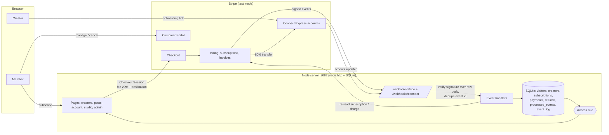

# Studio Pass: memberships and creator payouts on Stripe (test mode)

**Live demo:** https://members.kabiirlabs.com (Stripe **test mode**; pay with `4242 4242 4242 4242`, any future date, any CVC)

A small, complete membership platform for a fictional set of creators:

- Members subscribe to a creator **monthly or yearly** through **Stripe Checkout** and get that creator's members-only posts.
- Members switch plans, update their card and cancel in the **Stripe Customer Portal**.
- Creators onboard with **Stripe Connect Express** (Stripe-hosted account links) and are paid an **80 / 20 split** through destination charges with a 20% application fee.
- Access is granted and revoked **only by signed webhooks**: raw-body signature check, de-duplication by event id, safe against out-of-order delivery. Paid unlocks; failed, refunded and cancelled lock.
- An **admin page** shows members, every payment with its fee and transfer, creators' Connect status and every webhook delivery.

## Verified end to end on Stripe test mode (2026-11-08)

Run by hand through the real hosted pages (Checkout, Customer Portal, Connect onboarding), with events delivered by Stripe to the public endpoints:

| Step | What happened | Webhooks applied |
|---|---|---|
| Creator onboarding | 2 creators onboarded on Stripe-hosted pages with Stripe's test data (test phone, test code, Stripe test bank). Status flipped to "open for members" from `account.updated` | `account.updated` ×7 (Connect endpoint) |
| Subscribe | `4242 4242 4242 4242`, $8/month. The success page waited for the webhook, then the members-only posts unlocked | `checkout.session.completed`, `customer.subscription.created`, `invoice.paid` |
| Plan change | Portal: monthly → yearly, $72.00 charged ($80 − $8 unused credit) | `customer.subscription.updated`, `invoice.paid` |
| Cancel | Portal: cancel immediately → locked | `customer.subscription.deleted` |
| Failed renewal | Renewal against Stripe's always-declining test card → `past_due` → locked | `invoice.payment_failed` |
| Recover | Open invoice paid with a working test card → unlocked | `invoice.paid` |
| Refund | Full refund with transfer reversal and fee refund → locked | `charge.refunded`, `customer.subscription.deleted` |
| Split | Every paid invoice recorded 20% fee / 80% creator share. The creator's Stripe balance (pending $76.80 before the last $80 yearly payment) matched the sum of the recorded 80% shares exactly | – |

Every delivery returned 200 on first attempt; none failed signature checks. Things the live run caught that fixture tests had not: invoice webhook bodies don't include `payments`, so the PaymentIntent is read from Stripe; a destination charge transfers the full amount and then takes the fee back, so the creator share is amount − fee, not the transfer's face value; a shared portal configuration would let a member switch to another creator's price while the payout still went to the first creator (now one configuration per creator); `create_prorations` double-counted a monthly→yearly switch ($152) where `always_invoice` gives the correct $72; new sandboxes only allow Connect account creation through Accounts v2.

## Architecture



Request path for one membership:

1. `POST /subscribe` creates (or reuses) a Stripe customer for this browser and a Checkout Session in `subscription` mode with `subscription_data.application_fee_percent = 20` and `transfer_data.destination = <creator's Express account>`. Every renewal invoice inherits the split.
2. The success redirect unlocks nothing. `/account` waits until the webhook has written the subscription.
3. `checkout.session.completed` / `invoice.paid` arrive at `/webhooks/stripe`. The receiver verifies `Stripe-Signature` over the exact bytes received (constant-time compare, 5-minute window both ways), claims the event id in `processed_events` (`in_flight` / `done` / `failed`), then runs the handler. Handler error → `500`, so Stripe retries; duplicate → `200 duplicate`.
4. Handlers never trust an event body for subscription state. They re-read the subscription from Stripe (with the latest invoice's payment), so a late or repeated event can't roll access back. Invoice status only moves forward (`failed` never overwrites `paid`) and refund amounts only grow.
5. The access rule (`src/access.ts`) is one function: open only if Stripe says `active`/`trialing`, the latest invoice is paid, the paid-through date is in the future and the paying charge isn't fully refunded.

## Real vs simulated

| Part | Status |
|---|---|
| Stripe Checkout (subscription mode), card entry, 3-D Secure test card | **Real** Stripe test mode |
| Recurring prices (monthly, annual) per creator, created through the API | **Real** test mode |
| Customer Portal (monthly ↔ yearly with immediate proration, card update, cancel immediately), one configuration per creator so a plan change can't move money to another creator | **Real** test mode |
| Connect accounts (Accounts v2, Express dashboard, "recipient" configuration) and Stripe-hosted onboarding | **Real** test mode, filled with Stripe's test shortcuts (test phone, test code, test bank) |
| 80/20 split: application fee 20%, transfer 80% to the creator's account | **Real** test-mode transfers and application fees |
| Payouts from the creator's Stripe balance to a bank | Stripe's test payouts to a test bank account; no real bank |
| Webhooks: two endpoints (platform + Connect) created through the API, signed by Stripe, delivered over the internet | **Real** |
| "Simulate failed renewal" button | **Real** Stripe calls: attaches Stripe's always-declining test card and resets the billing anchor to now (subscriptions use classic billing mode so this bills a full period), so Stripe sends a real `invoice.payment_failed`. It replaces waiting a month for a renewal |
| "Refund last payment" button | **Real** refund with transfer reversal and fee refund, then a real cancel |
| Member sign-in | **Simplified**: no passwords, memberships belong to the browser (signed HttpOnly cookie) |
| Creators, posts, prices | **Fictional** content |
| Money | **None moves.** Test mode only; the server refuses to start with a live key and rejects live-mode events |

## Run it

Needs Node 24+ (uses built-in TypeScript type stripping and `node:sqlite`), a Stripe account in test mode with Connect enabled, and a public URL for webhooks.

```bash
npm ci
cp .env.example .env            # put your sk_test_ key and public URL in it
npm run seed                    # 3 fictional creators: products, prices, portal configs, connected accounts (Accounts v2)
npm run setup:stripe            # webhook endpoints + portal configuration (writes secrets into .env)
npm run seed -- --links         # onboarding links for the seeded creators (fill with Stripe test data)
npm start                       # http://127.0.0.1:8082
```

```bash
npm test                        # vitest
npm run typecheck               # tsc --noEmit
```

On the demo host the server runs under a launchd agent (`deploy/com.kabiirlabs.stripe-membership.plist`) behind a Cloudflare tunnel.

## Files

| File | What it does |
|---|---|
| `src/app.ts` | Routes and pages: creators, creator page with gated posts, subscribe, account, portal, demo controls, become-a-creator, creator studio, admin, webhooks |
| `src/handlers.ts` | Event → state: checkout, subscription lifecycle, invoice paid/failed, refunds, `account.updated` |
| `src/access.ts` | The one access rule, plus labels |
| `src/gateway.ts` | All Stripe calls (official SDK, API version `2026-10-28`): Checkout, portal, Accounts v2 + account links, refunds; normalises the current shapes (period end on subscription items, invoice payments) |
| `src/db.ts` | SQLite schema and monotonic upserts |
| `src/kit/` | Signature check, event-id dedupe store and framework-free webhook receiver |
| `scripts/seed.ts`, `scripts/setup-stripe.ts` | Idempotent setup of creators, prices, Express accounts, webhook endpoints and the portal configuration |
| `test/` | Access rules, handlers (ordering, duplicates, refunds), the HTTP webhook endpoint, page gating, and a cross-check against the official `stripe` package's verifier |

## Limits

- One process and one SQLite file; fine for a demo, not a scaled deployment.
- No accounts or passwords: a member who clears cookies loses access to their membership page (the Stripe subscription still exists).
- The admin page is public on purpose for the demo (emails masked); a real one needs auth.
- Visitor-created creators get sample posts only (no free-text publishing, to keep the public demo clean).
- Taxes, coupons, trials, disputes and multi-currency are not covered. Checkout has Adaptive Pricing off so prices and the split stay in USD.
- Two of the three demo creators were left mid-onboarding on purpose, to show the "payout setup pending" state.

## License

MIT
